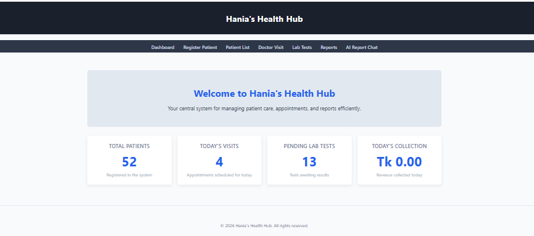
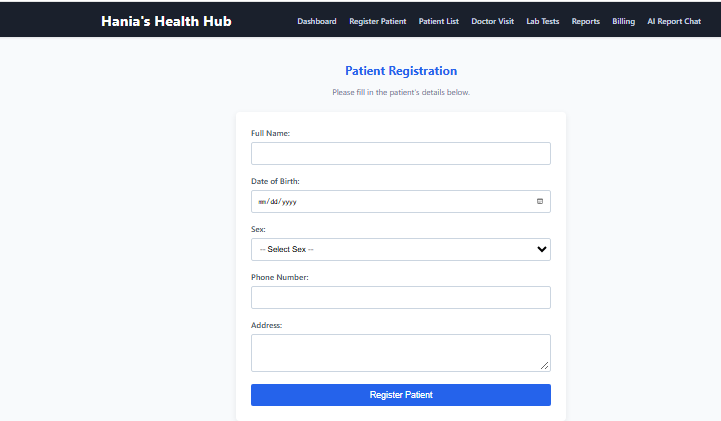
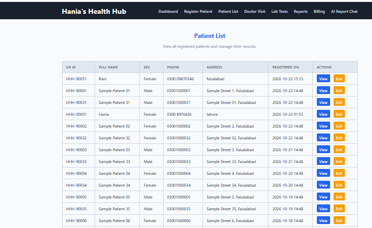
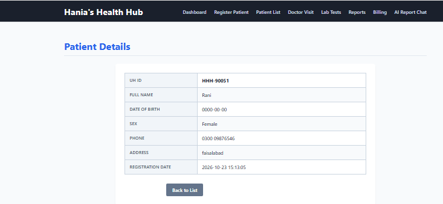
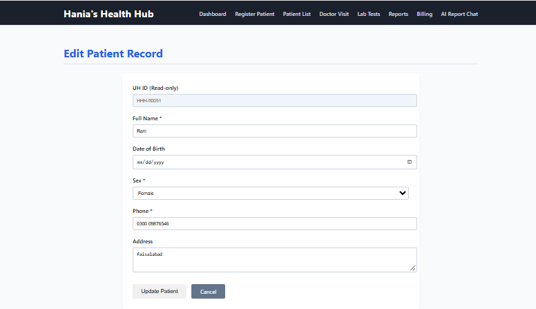
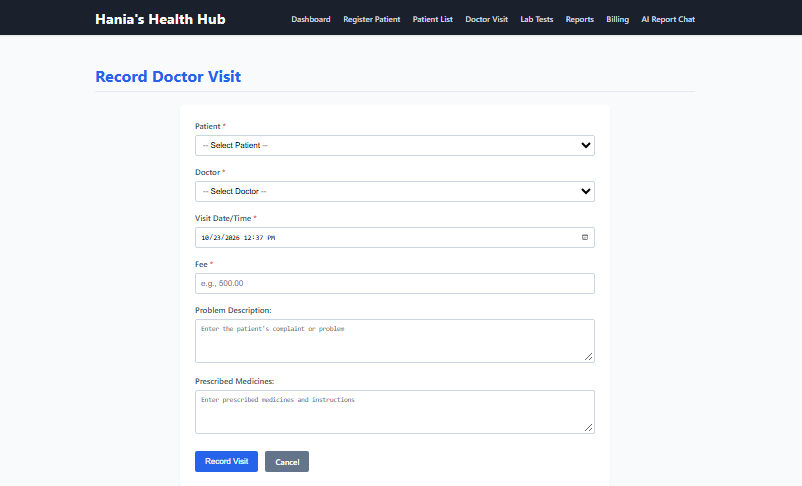
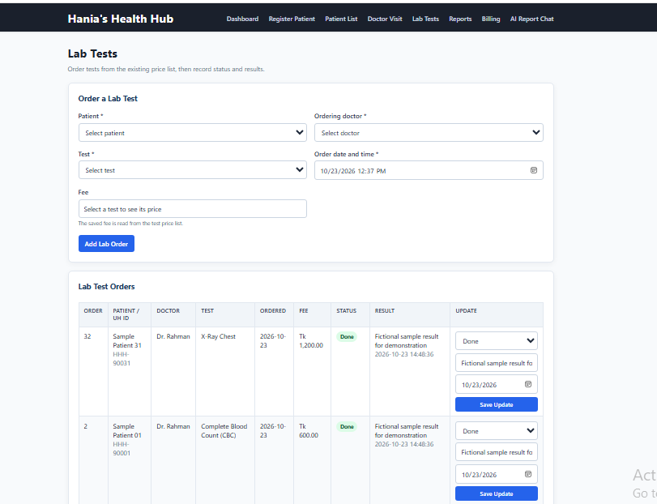
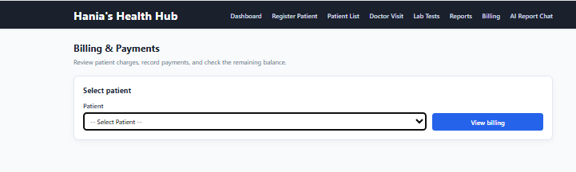
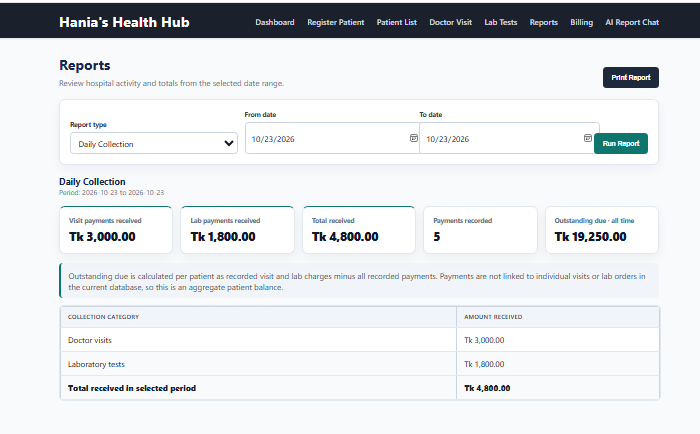
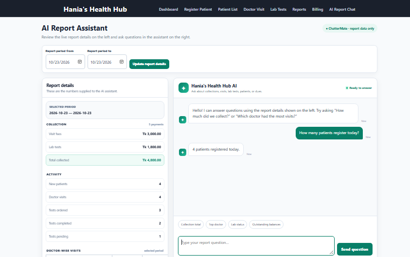

# Hania’s Health Hub with AI Facilitation

A database-driven hospital management system built with **PHP, MySQL, XAMPP, and Node.js**, featuring patient management, doctor visits, laboratory orders, billing, reports, and a ChatterMate-powered AI report assistant.

> **Academic/demo project:** This application uses fictional data only. Do not use it with real patient, hospital, or staff information without adding appropriate security, privacy, and compliance controls.

---

## Contents

- [Overview](#overview)
- [Features](#features)
- [Screenshots](#screenshots)
- [Technology Stack](#technology-stack)
- [Project Structure](#project-structure)
- [Database Structure](#database-structure)
- [Local Installation](#local-installation)
- [Running the Application](#running-the-application)
- [AI Report Assistant](#ai-report-assistant)
- [Security](#security)
- [Testing Checklist](#testing-checklist)
- [Project Status](#project-status)
- [License](#license)

---

## Overview

**Hania’s Health Hub with AI Facilitation** connects common hospital-management workflows in one system.

The application allows hospital staff to:

- Register and manage patients.
- Generate unique UH IDs for patients.
- Record doctor visits and prescriptions.
- Order laboratory tests and update test results.
- Record patient payments.
- Review charges and outstanding balances.
- Generate date-filtered operational reports.
- Ask questions about report data through an AI assistant.

The PHP application runs through **Apache in XAMPP**. MySQL stores the application records, while a separate Node.js server securely connects the application to the ChatterMate API.

---

## Features

### Dashboard

- Displays total registered patients.
- Shows today’s doctor visits.
- Shows pending laboratory tests.
- Displays today’s collection.
- Provides navigation to all major modules.

### Patient Management

- Register new patients.
- Generate a unique UH ID for every patient.
- View all registered patients.
- View detailed patient information.
- Edit patient records.
- Store patient name, date of birth, sex, phone number, and address.
- Use fictional sample records for demonstration.

### Doctor Visits

- Select a patient and doctor.
- Record the visit date.
- Record consultation fees.
- Store the patient’s complaint or problem description.
- Store prescribed medicines and instructions.
- Associate the visit with the patient’s UH ID.

### Laboratory Management

- Display available laboratory tests and prices.
- Order a laboratory test for a patient.
- Select the ordering doctor.
- Save the test fee at the time of ordering.
- Track pending and completed tests.
- Add fictional test results.
- Record result dates.

### Billing and Payments

- Review patient-related charges.
- Display total charges, paid amounts, and outstanding balances.
- Record payments using:
  - Cash
  - Card
  - bKash
- Categorize payments as:
  - Visit Fee
  - Lab Test

### Reports

- Filter reports by start date and end date.
- Display daily collection totals.
- Separate doctor-visit payments from laboratory payments.
- Show patient registration activity.
- Show doctor-wise visit counts and fees.
- Show laboratory orders by status.
- Display total rows.
- Provide print support.

### AI Report Assistant

- Displays report details beside the chat interface.
- Sends report data and staff questions to the local Node.js server.
- Uses ChatterMate to generate report-based answers.
- Keeps the API key away from browser code.
- Answers questions only from the supplied report data.
- Does not edit or delete hospital records.

---

## Screenshots

The following screenshots show the main screens in the order of the typical user workflow.

### 1. Dashboard



### 2. Patient Registration



### 3. Patient List



### 4. Patient Details



### 5. Edit Patient Details



### 6. Doctor Visit



### 7. Laboratory Tests



### 8. Billing and Payments



### 9. Reports



### 10. AI Report Assistant



> **Note:** GitHub paths are case-sensitive. The image paths above match the filenames in the `screenshots` folder exactly.

---

## Technology Stack

| Layer | Technology |
|---|---|
| Frontend | HTML, CSS, JavaScript |
| Application backend | PHP |
| Database | MySQL |
| Local web server | Apache through XAMPP |
| Database administration | phpMyAdmin |
| AI service bridge | Node.js using built-in modules |
| AI provider | ChatterMate |
| Development environment | Visual Studio Code |

---

## Project Structure

```text
hanias_health_hub/
├── .env                    # Local secret; never commit this file
├── .gitignore              # Git exclusions
├── README.md               # Project documentation
├── index.php               # Main application entry page
├── server.js               # Node.js AI API server
│
├── css/
│   └── style.css           # Shared application styles
│
├── includes/
│   ├── db.php              # MySQL database connection
│   ├── header.php          # Shared header and navigation
│   └── footer.php          # Shared footer and scripts
│
├── js/
│   └── script.js           # Shared browser-side JavaScript
│
├── pages/
│   ├── ai_chat.php
│   ├── billings.php
│   ├── dashboard.php
│   ├── doctor_visit.php
│   ├── lab_tests.php
│   ├── patient_details.php
│   ├── patient_edit.php
│   ├── patient_list.php
│   ├── patient_registration.php
│   └── reports.php
│
├── reports/
│   └── daily_collection.php
│
├── screenshots/
│   ├── AI_report_chat.PNG
│   ├── billing.PNG
│   ├── dashboard.PNG
│   ├── doctor_visit.PNG
│   ├── edit_patient_details.PNG
│   ├── lab_tests.PNG
│   ├── patient_list.PNG
│   ├── register_patient.PNG
│   ├── reports.PNG
│   └── view_patient_details.PNG
│
└── server/
    └── ask_ai.php
```

---

## Database Structure

The application uses the following core MySQL tables:

| Table | Purpose |
|---|---|
| `patients` | Stores patient profiles and UH IDs |
| `doctors` | Stores doctor names, departments, and fees |
| `visits` | Stores doctor visits, complaints, prescriptions, fees, and dates |
| `lab_tests` | Stores the laboratory test catalogue and prices |
| `lab_orders` | Stores patient laboratory orders, fees, results, and statuses |
| `payments` | Stores patient payments, methods, categories, and dates |

### Important Columns

The current application uses these important column names:

```text
visits.complaint
visits.prescription

lab_orders.patient_id
lab_orders.doctor_id
lab_orders.uh_id
lab_orders.test_id
lab_orders.fee
lab_orders.status
lab_orders.result
lab_orders.result_date
lab_orders.order_date
```

Payments are associated with patients using `uh_id`. Because payments are not connected to a specific visit or laboratory order, outstanding balances are calculated at the patient level.

---

## Local Installation

### Prerequisites

Install or prepare the following:

- XAMPP with Apache and MySQL.
- Node.js.
- Visual Studio Code or another code editor.
- A modern web browser.
- A ChatterMate API key.

### 1. Clone the repository

Open PowerShell or the VS Code terminal and run:

```powershell
cd C:\xampp\htdocs
git clone https://github.com/Hania-Emaan/Hania-s-Health_Hub-with-AI-Facilitation.git hanias_health_hub
```

Alternatively, download the repository as a ZIP file and extract it into:

```text
C:\xampp\htdocs\hanias_health_hub
```

### 2. Start XAMPP

Open the XAMPP Control Panel and start:

- Apache
- MySQL

### 3. Configure the database

1. Open phpMyAdmin:

   ```text
   http://localhost/phpmyadmin/
   ```

2. Create or select a database named:

   ```text
   hanias_health_hub
   ```

3. Create the required tables using the project database schema.
4. Open:

   ```text
   includes/db.php
   ```

5. Confirm that the database settings match your local MySQL configuration.

The default XAMPP connection commonly uses:

```php
$db_host = 'localhost';
$db_name = 'hanias_health_hub';
$db_user = 'root';
$db_pass = '';
```

If your MySQL username or password is different, update `includes/db.php`.

---

## Running the Application

### Start the PHP website

With Apache and MySQL running, open:

```text
http://localhost/hanias_health_hub/
```

### Configure the AI server

Create a file named `.env` in the project root, beside `server.js`:

```env
CHATTERMATE_API_KEY=your_private_key_here
```

Replace the placeholder with your private API key locally.

### Start the Node.js server

Open a terminal in the project root:

```powershell
cd C:\xampp\htdocs\hanias_health_hub
node --env-file=.env server.js
```

Keep this terminal open while using the AI report assistant.

If the server provides a health endpoint, test it at:

```text
http://localhost:3000/health
```

---

## Sample Data

The project uses fictional sample records for demonstration and testing.

Sample data should include:

- Patients
- Doctors
- Doctor visits
- Laboratory orders
- Laboratory results
- Payments

If you use a SQL seed script, check whether it is safe to run more than once. Running a non-repeatable seed script multiple times may create duplicate records.

Before demonstrating the project, verify that:

- Patients appear in the patient list.
- Doctor visits appear in the reports.
- Laboratory orders show the correct test names and prices.
- Payments appear in billing and collection reports.
- Report totals match the underlying database records.
- AI answers match the displayed report values.

---

## AI Report Assistant

The AI assistant is designed to answer questions using the report data supplied by the application.

Example questions include:

- How much was collected during the selected period?
- How much was collected from doctor visits?
- How much was collected from laboratory tests?
- Which doctor had the most visits?
- How many laboratory tests are pending?
- How many new patients were registered?
- What is the outstanding amount?

The assistant should:

- Use only the supplied report data.
- Avoid inventing figures.
- Say when the available data does not contain an answer.
- Keep answers concise.
- Refuse requests to edit or delete records.
- Keep the API key hidden on the server.

---

## GitHub Security

Before pushing this project to GitHub:

1. Confirm that `.env` is included in `.gitignore`.
2. Confirm that `.env` is not tracked by Git.
3. Never commit the real API key.
4. Do not commit real patient or hospital information.
5. Do not commit database exports containing sensitive data.
6. Use fictional data in screenshots and demonstrations.
7. Do not include passwords or private configuration files.

Recommended `.gitignore` file:

```gitignore
.env
.env.*
!.env.example
node_modules/
*.log
*.sql
*.zip
```

You may create an `.env.example` file with a placeholder:

```env
CHATTERMATE_API_KEY=your_key_here
```

---

## Testing Checklist

- [ ] Dashboard loads successfully.
- [ ] Patient registration creates a new patient and UH ID.
- [ ] Patient list displays saved patients.
- [ ] Patient details page opens correctly.
- [ ] Patient editing updates the selected record.
- [ ] Doctor visit records save correctly.
- [ ] Visit complaints and prescriptions are stored correctly.
- [ ] Laboratory orders save with the correct test and fee.
- [ ] Laboratory statuses can be updated.
- [ ] Laboratory results can be recorded.
- [ ] Billing displays patient charges.
- [ ] Payments can be recorded using Cash, Card, or bKash.
- [ ] Outstanding balances are calculated correctly.
- [ ] Reports respond correctly to date filters.
- [ ] Report totals match the database records.
- [ ] Reports can be printed.
- [ ] Node.js AI server starts successfully.
- [ ] AI assistant answers questions using report data.
- [ ] AI assistant does not expose the API key.
- [ ] `.env` is not present in the GitHub repository.

---

## Project Status

The core academic/demo functionality is complete, including:

- Patient management
- Doctor visit management
- Laboratory management
- Billing and payments
- Operational reports
- ChatterMate-powered AI report assistance

This project is intended for local academic and demonstration use. It is not intended for production use with real patient data.

A production deployment would require additional:

- Authentication
- Role-based access control
- Encryption
- Audit logging
- Automated backups
- Privacy controls
- Monitoring
- Compliance safeguards
- Secure hosting configuration

---

## License

This project is created for educational and demonstration purposes.

Add a specific open-source license here if you plan to allow other developers to reuse, modify, or distribute the project.